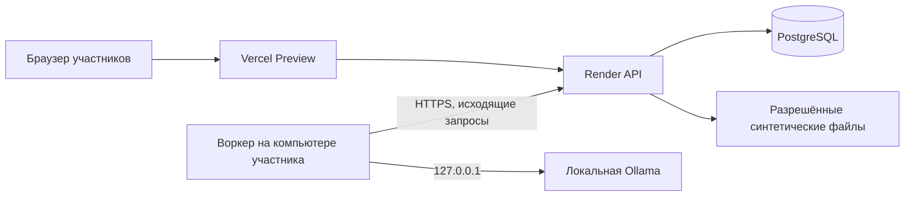

# Облачное демо с локальным воркером

[NRT-95](https://linear.app/andreiakimov/issue/NRT-95/podklyuchit-ml-adapter-k-worker-i-sohraneniyu-rezultata)
задаёт передачу пакета воркеру и сохранение результата. По
[NRT-108](https://linear.app/andreiakimov/issue/NRT-108/razvernut-demo-doccheck-na-vercel-i-render)
демо проверяется на синтетических данных. Этот документ описывает отдельный
закрытый стенд. В локальном запуске API, PostgreSQL, файлы, воркер и Ollama
остаются на машине участника. Их текущая очередь использует PostgreSQL
advisory lock и уже обслуживает локальную установку.

В первом стенде пользователь выбирает заранее подготовленный синтетический пакет.
API проверяет ID пакета по списку разрешённых манифестов, создаёт задание и
публикует статус и результат только для его владельца. Канонический манифест
содержит размеры и SHA-256. Разрешённые входные образцы включаются в отдельный
артефакт стенда, доступный API. При таком варианте Render восстанавливает
оригиналы из артефакта сборки, а не из каталога, который исчезает после рестарта.
Браузерные поля локального выбора произвольных файлов остаются в локальном режиме.
Чтобы позже разрешить загрузку согласованных образцов, потребуется закрытое
хранилище, ограничение размеров и серверная проверка допуска пакета к облаку.
Флаг из запроса, имя файла и MIME-тип не подтверждают допуск.

## Граница доступа

- Отдельные Render API/БД и Vercel Preview. Сервер проверяет сессию участника
  и владельца задания даже для запросов напрямую на Render. Защита Preview
  ограничивает веб-интерфейс, а правила API не зависят от неё. Оригиналы,
  доказательства, XLSX и история наследуют то же ограничение. Закрытое демо
  не меняет действующий публичный режим с блокировкой `/api/v0/runs`.
- Воркер получает отдельный ротируемый секрет, выданный для синтетического
  пула. API хранит проверяемый отпечаток. Запросы к воркерным маршрутам идут
  напрямую на согласованный HTTPS-origin Render. Секрет хранится на машине
  оператора и отсутствует в браузере, URL и логах. API определяет worker ID
  и пул из учётных данных, а не из полей запроса. ID аренды сам по себе
  не даёт доступ. Область выдачи файла — текущее задание этого воркера.
- Ollama принимает запросы только на `127.0.0.1`, облачные вызовы отключены.
  PostgreSQL недоступна с компьютера участника напрямую. Входы и результаты
  передаются через отдельно включённый закрытый стенд только после допуска
  по [режиму данных](../data-policy.md). До отдельного решения владельцев
  работают только выбранные обезличенные синтетические комплекты.

## Протокол

| Действие | Проверка | Результат |
| --- | --- | --- |
| `POST /api/worker/v1/claims` | Учётные данные, пул, ограничение частоты. PostgreSQL блокирует выбранную запись через `FOR UPDATE SKIP LOCKED`. | Текущая аренда с непрозрачным ID, поколением, сроком, манифестом и областью. Пустая очередь — 204, клиент повторяет с паузой. |
| `GET /api/worker/v1/claims/{lease_id}/files/{file_id}` | Действующая аренда этого воркера, ID файла в манифесте. | Проверенный поток байтов и размер. После загрузки воркер сверяет размер и SHA-256, сохраняет только под серверным ID во временной папке и передаёт адаптеру проверенный пакет. |
| `POST /api/worker/v1/claims/{lease_id}/heartbeat` | Активная аренда того же поколения. БД сравнивает собственное время, в запросе нет клиентского срока. | Продление аренды. Стартовый интервал зависит от замеров; для прототипа 15 секунд между heartbeat и 60 секунд до истечения. |
| `PUT /api/worker/v1/claims/{lease_id}/result` | Действующая аренда, ограниченный JSON, канонический CheckJob, совпадение ID, хешей оригиналов и области. | Результат и терминальный статус сохраняются атомарно. Повтор с тем же каноническим хешем получает тот же успех, другой результат — конфликт. |

Обрыв соединения во время обработки даёт ограниченное число повторов.
Каждое переприсвоение создаёт новую аренду и поколение. Просроченный
обработчик больше не может загрузить данные или зафиксировать результат,
даже если он ещё вычисляется. Воркер прекращает текущую работу при
потере аренды, либо отбрасывает результат, если отмена уже невозможна.
Heartbeat идёт независимо от вызова модели. PostgreSQL завершает последнюю
истекшую попытку понятной технической ошибкой. Лимит задач, отдельное
ограничение размера файла/результата, срок хранения и удаление временных файлов
фиксируются до открытия стенда. Отдельный общий дедлайн задачи ограничивает
продления зависшего процесса.

Запись `Run` и контракт результата остаются единственным источником данных
для UI. Новая таблица аренды хранит область пула, владельца, поколение, срок
действия и хеш завершения. Локальный воркер с advisory lock и облачная аренда
обслуживают разные базы и не конкурируют за одну очередь. Код проверки
терминального результата должен быть общим, чтобы облачный маршрут не обходил
проверку оригиналов, области и ошибок.

## Проверено и осталось

[Прототип PostgreSQL](../../research/local-worker-lease/) проверил блокировку
параллельных захватов, область пула и владельца, истечение аренды, отказ старому
воркеру после переприсвоения, идемпотентное завершение и отказ по исчерпании
попыток. Все три теста прошли на отдельной PostgreSQL 18.4. Артефакт содержит
только экспериментальный SQL и тест; он не импортируется сервером приложения.

Перед публикацией нужны схема выбора пакета и допуск образцов, согласованные
учётные записи участников, реализация закрытых API/клиента воркера, проверка
неподходящих учётных данных и истечения аренды, проверка загрузки и выдачи
оригиналов, остановка ПК во время работы и проверка восстановления через
Preview. Запуск существующего публичного Render API сам по себе этого не
реализует. Хранилище произвольных пакетов требует решения владельца. На Render
встроенный диск доступен для платных сервисов, а файловая система по
умолчанию очищается при перезапуске сервиса.
[Документация Render](https://render.com/docs/disks)
· [Маршрутизация Vercel](https://vercel.com/docs/rewrites)
